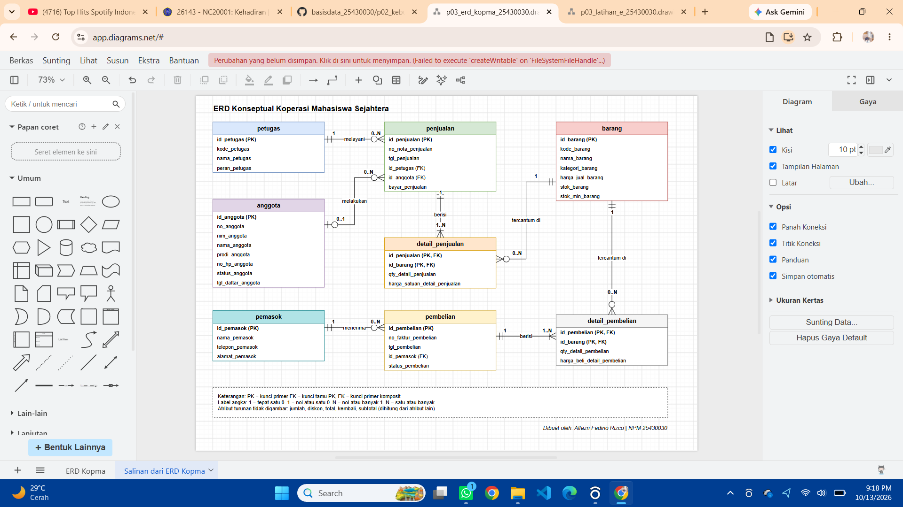
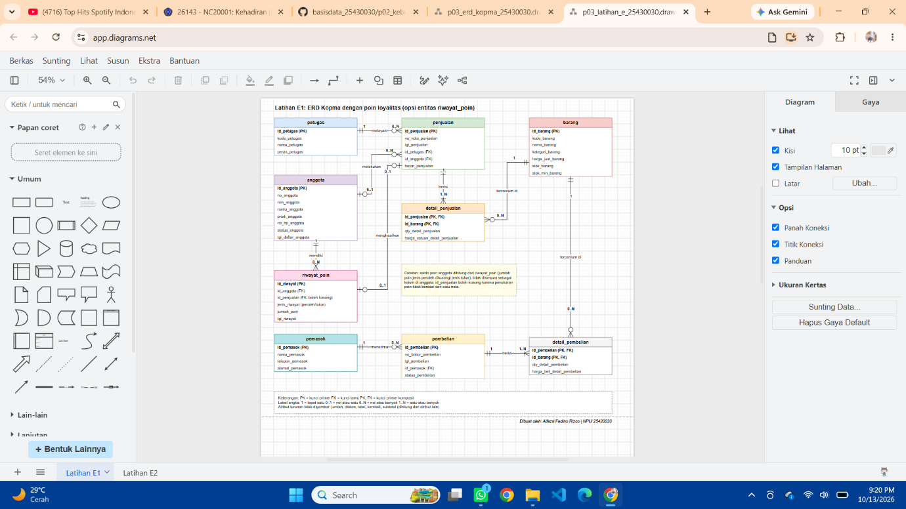
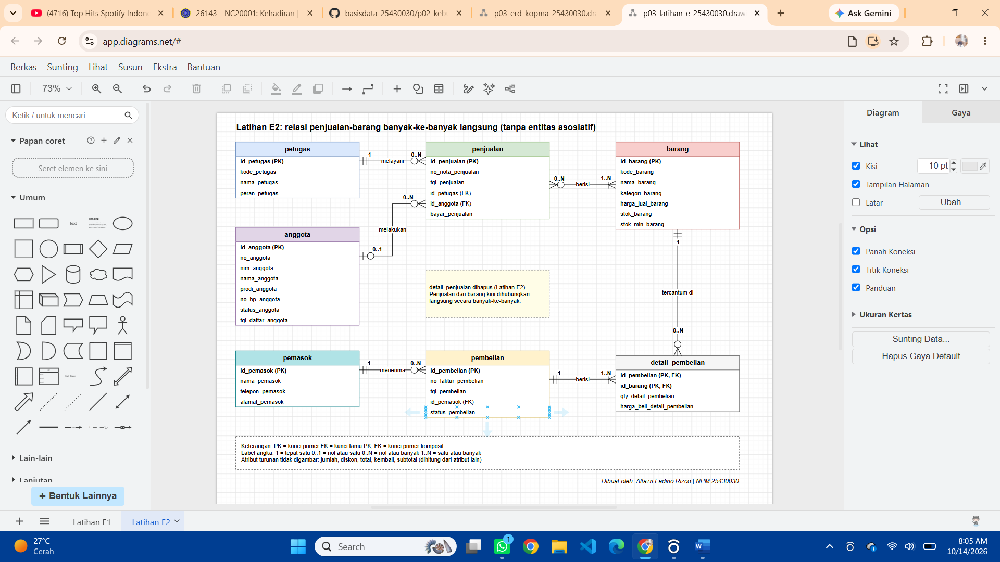
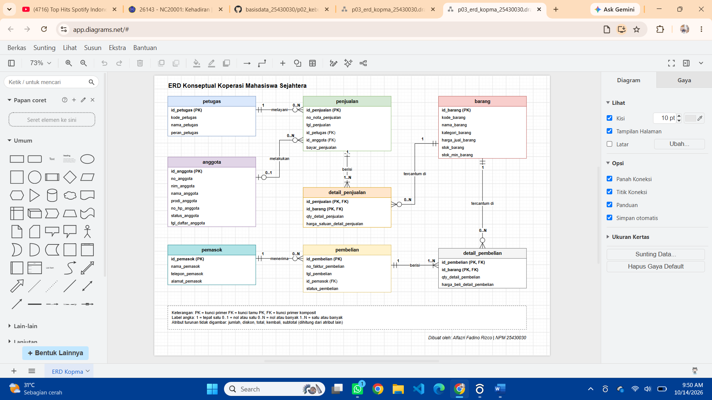

# Laporan Praktikum Basis Data - Pertemuan 03

| **Identitas** | **Keterangan**           |
|---------------|--------------------------|
| Nama          | Alfazri Fadino Rizco     |
| NPM           | 25430030                 |
| Kelas         | B                        |
| Tanggal       | 14-10-2026               |
| Asisten/Dosen | Dedi Irawan S.Kom, M.Kom |

## 1. Tujuan Praktikum

- Mengubah dokumen kebutuhan data pertemuan 2 menjadi ERD konseptual dengan notasi crows foot
- menentukan kunci, relasi, dan kardinalitas
- menelusuri kebutuhan informasi (KI) pada ERD dan meninjau ERD Bersama teman sebagai klien

## 2. Ringkasan Dasar Teori

Kardinalitas menjawab “berapa banyak sedangkan relasi partisipasi menjawab wajib atau boleh tidak ada. Notasi crows foot menggabungkan keduanya.

## 3. Hasil Langkah Percobaan

### D.1 Entitas, kunci, dan atribut turunan Kopma

| **Entitas**      | **Kunci primer**          | **Kunci alternatif**    | **Atribut turunan**            |
|------------------|---------------------------|-------------------------|--------------------------------|
| anggota          | id_anggota                | no_anggota, nim_anggota | -                             |
| barang           | id_barang                 | kode_barang             | -                             |
| petugas          | id_petugas                | kode_petugas            | -                             |
| pemasok          | id_pemasok                | -                      | -                             |
| penjualan        | id_penjualan              | no_nota_penjualan       | jumlah, diskon, total, kembali |
| detail_penjualan | (id_penjualan, id_barang) | -                      | subtotal                       |
| pembelian        | id_pembelian              | no_faktur_pembelian     | -                             |
| detail_pembelian | (id_pembelian, id_barang) | -                      | -                             |

### D.2 Relasi dan kardinalitas Kopma

| **Relasi**                                          | **Sisi kiri**         | **Sisi kanan**            | **Dasar**    |
|-----------------------------------------------------|-----------------------|---------------------------|--------------|
| petugas melayani penjualan                          | tepat satu petugas    | nol atau banyak penjualan | PB-02        |
| anggota melakukan penjualan                         | nol atau satu anggota | nol atau banyak penjualan | AB-04        |
| penjualan berisi detail_penjualan                   | tepat satu penjualan  | satu atau banyak detail   | AB-08        |
| barang tercantum di detail_penjualan                | tepat satu barang     | nol atau banyak detail    | AB-01, AB-02 |
| pemasok menerima pembelian                          | tepat satu pemasok    | nol atau banyak pembelian | AB-05        |
| pembelian berisi detail_pembelian                   | tepat satu pembelian  | satu atau banyak detail   |              |
| petugas menerima pembelian (hasil Titik Analisis 3) |                       |                           |              |

### D.3 ERD Kopma di draw.io

*Gambar 1. ERD Kopma (p03_erd_kopma_25430030.png)*

### D.4 Validasi ERD terhadap kebutuhan informasi Kopma

| **Kode** | **Kebutuhan informasi**                      | **Jalur di ERD**                       |
|----------|----------------------------------------------|----------------------------------------|
| KI-01    | Omzet dan jumlah nota per hari dan per bulan | penjualan                              |
| KI-02    | Lima barang terlaris per bulan               | barang → detail_penjualan              |
| KI-03    | Barang dengan stok di bawah batas minimum    | barang                                 |
| KI-04    | Sepuluh anggota dengan belanja terbesar      | anggota → penjualan → detail_penjualan |

## 4. Jawaban Titik Analisis

**Titik Analisis 1: no_anggota dan nim_anggota sama-sama unik. Mengapa kunci primer yang dipakai id_anggota, dan apa satu risiko bila NIM dijadikan kunci primer?**

Jika nim lama slaah ketik makan akan meribetkan atau menyusahkan petugas, karna harus mengganti nim terlebih dahulu

**Titik Analisis 2: sisi penjualan ke detail_penjualan bernilai satu atau banyak. Aturan bisnis mana yang memaksanya, dan dapatkah struktur tabel saja menjaganya?**

Aturan yang memaksanya adalh AB-01, jika hanya struktur tabel saja tidak akan cukup untuk menjaga aturan ini karena nota di buat lebih dulu

**Titik Analisis 3: ketua ingin tahu petugas gudang mana yang menerima barang dari pemasok. Apakah ERD sekarang dapat menjawabnya? Relasi apa yang perlu ditambahkan, dan perlukah aturan bisnis baru?**

ERD saat ini karena entitas pembelian tidak memiliki data saat petugsa Gudang menerimanya. Karena itu perlu di tambahkan relasi, dengan kardinalitas, di sisi petugas dan di sisi pembelian, keputusan ini perlu di caat sebagai pembelian baru.

### Latihan 1: poin loyalitas pada ERD Kopma

*Gambar 2. ERD Kopma dengan poin loyalitas (Latihan E1)*

### Latihan 2: relasi banyak-ke-banyak langsung

*Gambar 3. Penjualan dan barang dihubungkan langsung (Latihan E2)*

## 6. Tugas Mandiri: Milestone Proyek 3 (Perpustakaan Cendekia AFR)

### 6.1 Entitas, kunci, dan atribut turunan

| **Entitas**       | **Kunci primer**            | **Kunci alternatif** | **Atribut turunan**    |
|-------------------|-----------------------------|----------------------|------------------------|
| anggota           | Id_anggota                  | No_anggota           | -                     |
| petugas           | Id_petugas                  | Kode_petugas         | -                     |
| judul_buku        | Id_judul                    | Kode_judul           | -                     |
| eksemplar         | Id_eksemplar                | No_eksemplar         | -                     |
| peminjaman        | Id_peminjaman               | No_slip_peminjaman   | Jumlah buku dalam slip |
| detail_peminjaman | Id_peminjaman, id_eksemplar | -                   | Jumlah_hari_terlambat  |
| denda             | Id_denda                    | _no_kuitansi_denda  | Nominal_denda          |

### 6.2 Relasi dan kardinalitas

| **Relasi**                              | **Sisi kiri**               | **Sisi kanan**             | **AB dasar** |
|-----------------------------------------|-----------------------------|----------------------------|--------------|
| petugas melayani peminjaman             | tepat satu petugas          | nol atau banyak peminjaman | PB-02        |
| anggota melakukan peminjaman            | tepat satu anggota          | nol atau banyak peminjaman | AB-04        |
| judul_buku memiliki eksemplar           | Tepat satu judul buku       | Nol atau banyak eksemplar  | AB-08        |
| peminjaman berisi detail_peminjaman     | Tepat satu peminjaman       | Satu atau banyak detail    | AB-01, AB-02 |
| eksemplar tercatat di detail_peminjaman | Tepat satu eksemplat        | Nol atau banyak detail     | AB-05        |
| detail_peminjaman dikenai denda         | Tepat satu detail pminjaman | Nol atau satu denda        | AB-06        |

### 6.3 Penelusuran KI ke jalur ERD

| **Kode** | **Kebutuhan informasi**                    | **Jalur di ERD**                                                        |
|----------|--------------------------------------------|-------------------------------------------------------------------------|
| KI-01    | Transaksi perhari dan perbulan             | Peminjaman                                                              |
| KI-02    | Lima judul paling sering di pinjam         | Judul buku, ke ekseplar, kedetail peminjaman                            |
| KI-03    | Buku yang sering di pinjam dan lewat batas | Detail peminjaman, ke eksemplar, ke judul buku, dan peminjaman, anggota |
| KI-04    | Total denda perbulan                       | Detail peminjaman , anggta                                              |
| KI-05    | Anggota paling aktif meminjam              | Anggota, peminjman                                                      |

### 6.4 Pemetaan entitas ke proses bisnis dan KI

| **Entitas**       | **Proses bisnis (PB)** | **Kebutuhan informasi (KI)** |
|-------------------|------------------------|------------------------------|
| anggota           | PB-01, PB-02           | KI-01, KI-05                 |
| petugas           | PB-02, PB-03, PB-06    | -                           |
| judul_buku        | PB-04                  | KI-02, KI-03                 |
| eksemplar         | PB-02, PB-03, PB-04    | KI-02, KI-03                 |
| peminjaman        | PB-02, PB-03           | KI-01, KI-05                 |
| detail_peminjaman | PB-02, PB-03           | KI-02, KI-03, KI-05          |

### 6.5 ERD Perpustakaan

*Gambar 4. ERD Perpustakaan Cendekia AFR (p03_erd_25430030.png)*

## 7. Pembahasan dan Kendala

Tidak ada kendala

## 8. Kesimpulan

Kardinalitas menjawab “berapa banyak sedangkan relasi partisipasi menjawab wajib atau boleh tidak ada. Notasi crows foot menggabungkan keduanya.

## 9. Pernyataan Penggunaan AI

Saya menggunakan ai untuk membuat kerangka laporan dan membuat tugas.

## 10. Bukti Git

Repositori: https://github.com/alfazridino160-hue/basisdata_25430030/commit/44aa8fa4a6a2d917f2c8187de4cb38615c6d1f7e#diff-6118ee9d2514ec35496a5e34785e1ca26417bbdac2f782fea7c5ee4a250cc89a

Hash commit: 44aa8fa4a6a2d917f2c8187de4cb38615c6d1f7e

Pesan commit: p03 laporan modul 3

## Checklist

### Checklist umum

- [ ] Identitas lengkap (nama, NPM, kelas, pertemuan, tanggal, asisten/dosen)
- [ ] Tujuan ditulis dengan bahasa sendiri (maks. 5 baris)

- [ ] Ringkasan teori maks. setengah halaman, tanpa menyalin buku
- [ ] Tangkapan layar langkah kunci disertai keterangan

- [ ] Semua Titik Analisis dijawab dengan alasan
- [ ] Latihan (E) disertai bukti

- [ ] Tugas Mandiri (F) berisi berkas, bukti, dan penjelasan desain
- [ ] Pembahasan memuat kendala, cara membaca galat, dan cara mengatasi

- [ ] Kesimpulan 2-4 kalimat
- [ ] Pernyataan penggunaan AI

- [ ] Bukti Git (tautan repositori dan hash commit)
- [ ] Keaslian: nama, NPM, dan nama organisasi tampil pada judul dan tanda tangan ERD

### Checklist khusus Pertemuan 3

- [ ] p03_erd_kopma_25430030 dan p03_erd_25430030 (gambar dan berkas sumber diagram)
- [ ] Bukti tangkapan layar: ERD di draw.io dengan kardinalitas terbaca; catatan tinjauan klien

- [ ] Analisis: pemetaan setiap entitas ke PB/KI dari Pertemuan 2; alasan kardinalitas relasi utama
