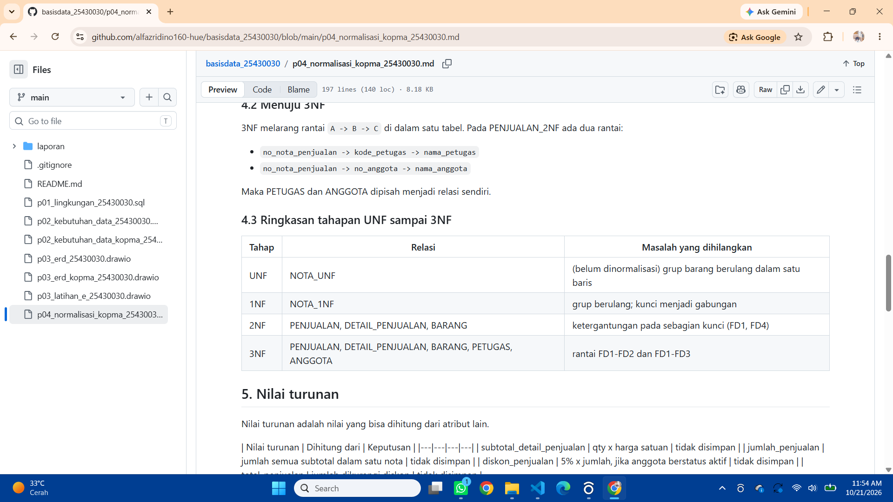
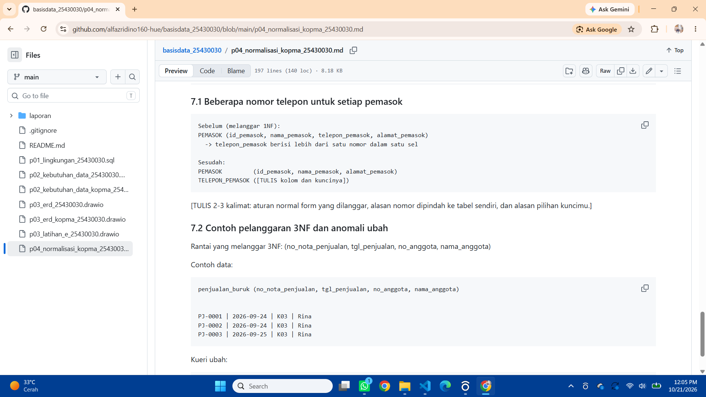

# Laporan Praktikum Basis Data - Pertemuan 04

**Nama:** Alfazri Fadino Rizco    **NPM:** 25430030    **Kelas:** B    **Tanggal:** [TULIS dd-mm-yyyy]

**Asisten/Dosen:** Dedi Irawan S.Kom, M.Kom

## 1. Tujuan Praktikum

- mengidentifikasi sebuah anomali ubah, sisip, dan hapus pada data yang belum di normalisasi
- menuliskan despendasi fungsional dari aturan bisnis
- menormalisasi relasi hingga bentuk normal ketiga dan memeriksa BCNF

## 2. Ringkasan Dasar Teori

- anomali ubah misalya harga pulpen berubah menjadi 5000, tetapi anya satu baris yang di perbarui. baris lain masih 4000.
- anomali sisip misalnya kopma ingin mencatat barang baru tetapi belum ada transaksi yang menggunakan barang itu.
- anomali hapus misalnya ingin menghapus satu baris pada nota penjualan atau pembelian tetapi malah terhapus semua.


## 3. Hasil Langkah Percobaan

**D.1 Anomali dan UNF ke 1NF (Kopma).** anomali yang saya temukan di nota pj-2609-0142 adalah kolom lain ikut berulang di setiap baris.

**D.2 Dependensi fungsional (Kopma).** Daftar dependensi FD1 sampai FD6 ditulis di `p04_normalisasi_kopma_25430030.md` bagian 3. | FD1 | no_nota_penjualan -> tgl_penjualan, kode_petugas, no_anggota | AB-01 (satu nota, satu tanggal, satu petugas) |

**D.3 2NF, 3NF, dan nilai turunan (Kopma).** 3NF melarang rantai `A -> B -> C` di dalam satu tabel. Pada PENJUALAN_2NF ada dua rantai:

- `no_nota_penjualan -> kode_petugas -> nama_petugas`
- `no_nota_penjualan -> no_anggota -> nama_anggota`

Maka PETUGAS dan ANGGOTA dipisah menjadi relasi sendiri.

**Bukti tahapan UNF sampai 3NF (Kopma):**



**D.4 Skema kanonik dan BCNF (Kopma).** BCNF mensyaratkan **setiap penentu adalah kunci kandidat**. Pemeriksaan untuk tiap tabel, Perbedaan utama dengan hasil normalisasi di atas: kunci primer memakai **kunci pengganti** `id_*`, sedangkan kode alami seperti `no_nota_penjualan` menjadi kunci unik. 

## 4. Jawaban Titik Analisis

**Titik Analisis 1 - Mengapa harga satuan berada pada kunci (no_nota_penjualan, kode_barang)?**

Harga satuan di tempatkan pada kunci gabungan karena harga bisa saja berbeda,pada satu barang yang sama pada nota yang berbeda jika haraga di pindah ketababel barang maka laporan omzet tahun lalu akan d hitung dengan haarga yang baru, jadi hal ini yang di keluhkan ketuA.

**Titik Analisis 2 - Mengapa keputusan "total tidak disimpan" tetap konsisten dengan tabel arsip yang menyimpan total?**

TOTAL tidak di simpan di tabel operasional karena data bisa saja berubah kapanpun pada arsip, total di simpan karena data sudah final dan tidak bisa lagi di ubah ubah, kedua keputusan tersebut konsisten karena agar menjaga kebenaran data dan keutuhan data.

**Titik Analisis 3 - Di mana informasi "barang ini dipasok oleh siapa" disimpan, dan apa keuntungannya?**

informasi pemasok di simpan di pada nota pembelian dan detail_pembelian yang terhbung ke tabel pemasok. ke untungannya adalah satu barang bisa saja di pasok oleh banyak pemasok juga riwyat di simpan dan nama pemasok bisa di ubah di satu tempat. 

## 5. Hasil Latihan dan Modifikasi

**Latihan 1 - Beberapa nomor telepon untuk setiap pemasok**

[TULIS ringkasan: aturan yang dilanggar (1NF), relasi baru beserta kuncinya, dan alasan pilihan kuncimu. Detailnya ada di `p04_normalisasi_kopma_25430030.md` bagian 7.1.]

**Latihan 2 - Contoh pelanggaran 3NF dan anomali ubah**

[TULIS ringkasan: rantai `no_nota_penjualan -> no_anggota -> nama_anggota`, contoh data, dan kueri ubah yang memperlihatkan anomalinya.]

```sql
UPDATE penjualan_buruk
SET nama_petugas = 'Rina Putri'
WHERE no_nota_penjualan = 'PJ-0001';
```




## 6. Tugas Mandiri: Milestone Proyek 4 (Perpustakaan Cendekia AFR)

**Dokumen sumber:** slip peminjaman (contoh `PJ-2610-0007`).

**Daftar dependensi fungsional beserta aturan bisnis yang mendasarinya**

Setiap FD diturunkan dari aturan bisnis, bukan dari isi contoh data.

| FD | Dependensi | Dasar |
|---|---|---|
| FD1 | no_slip_peminjaman -> tanggal_pinjam, kode_petugas, no_anggota | AB-01 [periksa kode AB] |
| FD2 | kode_petugas -> nama_petugas | satu kode petugas, satu nama |
| FD3 | no_anggota -> nama_anggota, jenis_anggota | AB-07 [periksa kode AB] |
| FD4 | no_eksemplar -> kode_judul, kondisi_eksemplar | AB-08 [periksa kode AB] |
| FD5 | kode_judul -> judul_buku, pengarang, penerbit, kategori_buku | satu kode judul, satu data judul |
| FD6 | (no_slip_peminjaman, no_eksemplar) -> tanggal_kembali | tiap buku dikembalikan pada waktunya sendiri |
| FD7 | tanggal_kembali, tanggal_harus_kembali -> jumlah_hari_terlambat | nilai turunan |
| FD8 | jumlah_hari_terlambat -> nominal_denda | AB-06, nilai turunan (hari x Rp4.000) |


**Bukti tahapan UNF sampai 3NF (proyek):**


**Keputusan nilai turunan**

| Nilai turunan | Dihitung dari | Keputusan | Alasan |
|---|---|---|---|
| jumlah_buku_slip | banyak baris detail dalam satu slip | disimpan | agar tidak terjadi anomali |
| jumlah_hari_terlambat | tanggal kembali dikurangi tanggal harus kembali | di hitung |  |
| nominal_denda | jumlah hari terlambat x Rp4.000 | di hitung |  |

**Hasil pemeriksaan BCNF:** Seluruh tabel hasil 3NF (PETUGAS, ANGGOTA, JUDUL_BUKU, EKSEMPLAR, PEMINJAMAN, DETAIL_PEMINJAMAN, dan DENDA) memenuhi BCNF karena setiap penentu pada dependensi fungsionalnya adalah kunci kandidat tabel itu, misalnya `no_slip_peminjaman` pada PEMINJAMAN dan `(no_slip_peminjaman, no_eksemplar)` pada DETAIL_PEMINJAMAN. Atribut `tanggal_harus_kembali` tidak dianggap ditentukan oleh `tanggal_pinjam`, karena masa pinjam dapat berubah sehingga nilainya adalah potret aturan saat peminjaman, sama seperti harga satuan pada nota. Kunci pengganti `id_*` pada ERD tidak menghapus dependensi tersebut.

**Keputusan letak `tanggal_harus_kembali`:** 

**Perubahan ERD:** 

Setelah normalisasi, atribut `tanggal_harus_kembali` dipindahkan dari entitas `detail_peminjaman` ke entitas `peminjaman`. Alasannya, sesuai AB-03, masa pinjam 7 hari berlaku untuk seluruh buku dalam satu slip, sehingga atribut tersebut hanya bergantung pada `no_slip_peminjaman` (FD1), bukan pada kunci gabungan `(no_slip_peminjaman, no_eksemplar)`. Atribut tetap disimpan karena masa pinjam dapat berubah dan slip lama harus mempertahankan batas yang berlaku saat peminjaman. Entitas lain dan seluruh relasi pada ERD Pertemuan 3 tidak berubah.

## 7. Pembahasan dan Kendala

**Kendala 1:** menentukan letak, gejalanya ragu atributnya ma di peminjaman atau detail_peminjaman, penyebabnya kunci detailnya gabungan, dan awalnya belum jelas atributitu bergantung kemana, cara mengatasinya menguji dengan sebuah pertanyaan "kalau hanya tau nomor slip, apakah tanggal harus sudah pasti?. karena AB-03 menetapkan pinjamamn 7 hari untuk satu slip , jadi atribut itu pindah ke peminjaman.


## 8. Kesimpulan

kesimpulan pada aporan modul 4 kali ini adalah bagaimana menormalisasikan ke 3 anomali ini (ubah, sisip, dan hapus) juga mengurus dispensasi fungsional dari aturan bisnis dan juga menormalisasi relasi smapai bentuk normal ketiga dan memeriksa BCNF
- mengidentifikasi sebuah anomali ubah, sisip, dan hapus pada data yang belum di normalisasi.
- menuliskan despendasi fungsional dari aturan bisnis.
- menormalisasi relasi hingga bentuk normal ketiga dan memeriksa BCNF.

## 9. Pernyataan Penggunaan AI
 
saya mengunakan ai untuk membuat kerngka laporan, membantu mengisi laporan dan dengerjakan tugas.

## 10. Bukti Git

- Repositori:https://github.com/alfazridino160-hue/basisdata_25430030/blob/main/p04_normalisasi_kopma_25430030.md
- Hash commit: `
- Pesan commit: `p04:normalisasi dan proyek'

## Checklist

**Checklist umum**

- [ ] Identitas lengkap (nama, NPM, kelas, pertemuan, tanggal, asisten/dosen)
- [ ] Tujuan ditulis dengan bahasa sendiri (maks. 5 baris)
- [ ] Ringkasan teori maks. setengah halaman, tanpa menyalin buku
- [ ] Tangkapan layar langkah kunci disertai keterangan
- [ ] Semua Titik Analisis dijawab dengan alasan
- [ ] Latihan (E) disertai bukti
- [ ] Tugas Mandiri (F) berisi berkas, bukti, dan penjelasan desain
- [ ] Pembahasan memuat kendala, cara membaca galat, dan cara mengatasi
- [ ] Kesimpulan 2-4 kalimat
- [ ] Pernyataan penggunaan AI
- [ ] Bukti Git (tautan repositori dan hash commit)
- [ ] Keaslian: dokumen sumber, dependensi, dan keputusan nilai turunan berasal dari aturan bisnis sendiri

**Checklist khusus Pertemuan 4**

- [ ] `p04_normalisasi_25430030.md` (proyek)
- [ ] Bukti tangkapan layar: tabel tahapan UNF, 1NF, 2NF, 3NF
- [ ] Analisis: daftar dependensi fungsional; keputusan menyimpan atau menghitung nilai turunan beserta alasannya
