# Laporan Praktikum Basis Data - Pertemuan 05

**Nama:** Alfazri Fadino Rizco    **NPM:** 25430030    **Kelas:** B    **Tanggal:** [10-11-2026]

**Dosen:** Dedi Irawan S.Kom, M.Kom

## 1. Tujuan Praktikum

tujuan praktikum kali ini adalah membangun skema relasional dari hasil normalisasi dengan perintah ddl, dengan memilih tipe data dan constraint yang menjaga aturan bisnis, dengan membuktikan constraint menolak data salah.

## 2. Ringkasan Dasar Teori

- DDL: CREATE, ALTER, DROP
- constraint: PRIMARY KEY, FOREIGN KEY, UNIQUE, CHECK, NOT NULL, DEFAULT
- pemilihan tipe data (DECIMAL untuk uang, ENUM untuk nilai terbatas, CHAR untuk format tetap)
- aksi ON DELETE (RESTRICT, CASCADE, SET NULL)
- urutan membuat dan menghapus tabel mengikuti kunci tamu

## 3. Hasil Langkah Percobaan

**D.1 Skrip DDL Kopma.** Skrip `p05_ddl_kopma_25430030.sql` membuat 8 tabel dan dapat dijalankan ulang karena diawali `DROP TABLE IF EXISTS` dari tabel anak ke induk. [TULIS 1-2 kalimat tambahan tentang cara kamu menjalankannya sebagai root.]

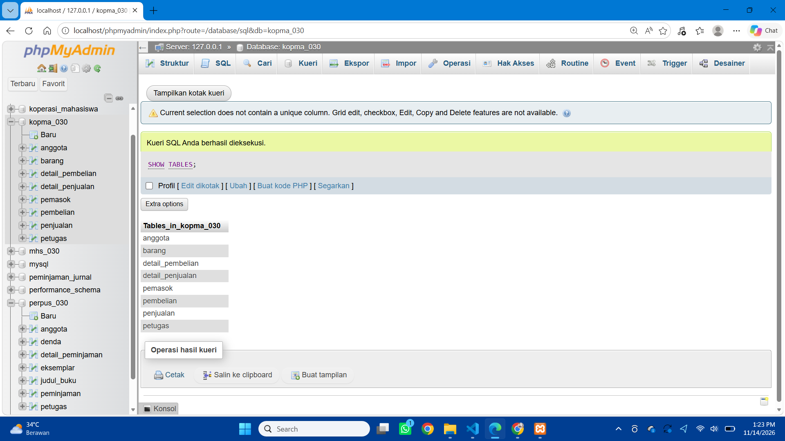

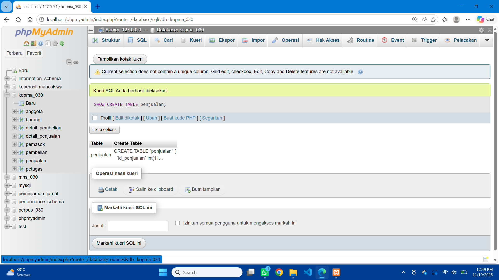

**D.2 Constraint menolak data salah.** Tiga pelanggaran sengaja dilakukan setelah data induk terisi.

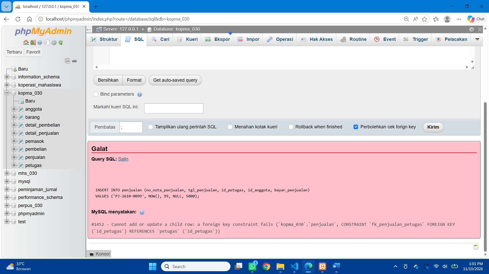

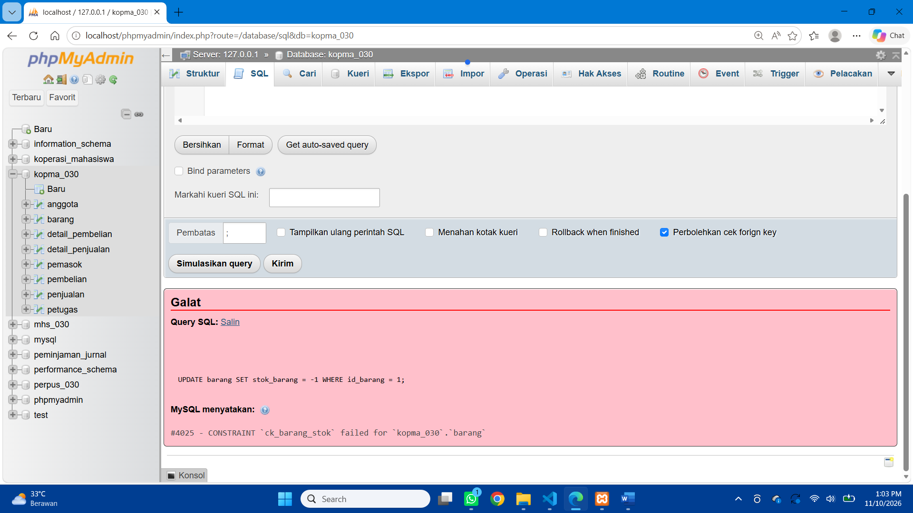

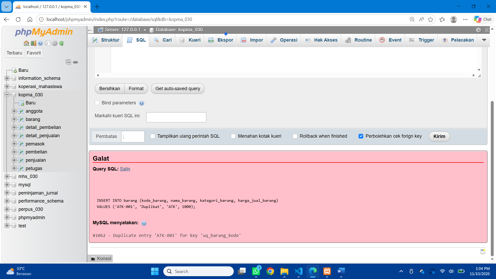


**D.3 ALTER TABLE.** 

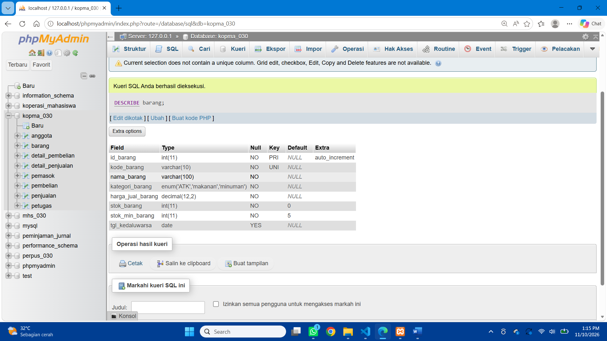

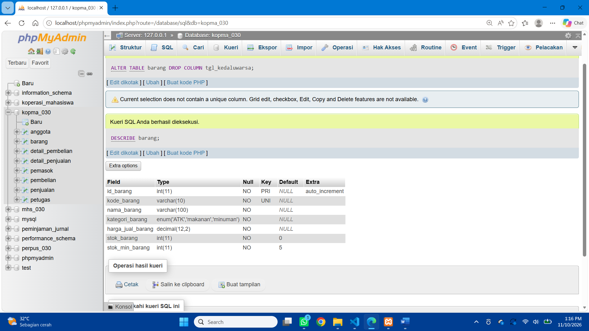

**D.4 Designer dan ERD.** 

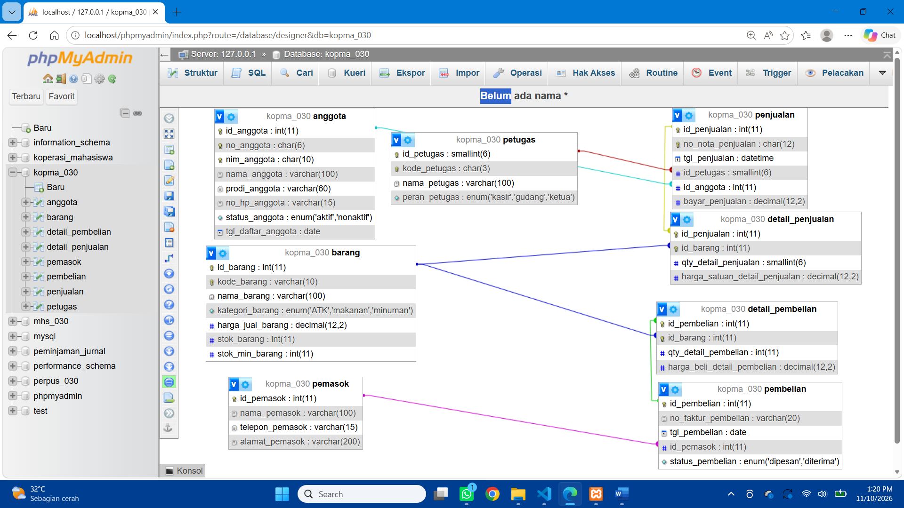

| Aspek | ERD Pertemuan 3 | Desain fisik (DDL dan Designer) | Catatan |
|---|---|---|---|
| Simbol relasi | Crow's Foot dengan label angka (1, 0..1, 0..N, 1..N) | Garis penghubung kunci tamu tanpa label kardinalitas | Designer hanya menunjukkan relasi, bukan kardinalitasnya, jadi angka tetap dibaca dari ERD |
| Tipe data | Belum ada, hanya nama atribut dan label PK/FK | DECIMAL(12,2), CHAR(12), ENUM, DATETIME, dan seterusnya | Tipe ditetapkan di Modul 5 sesuai ukuran dan format data |
| Constraint | Hanya PK dan FK | Ditambah UNIQUE, CHECK, DEFAULT, dan NOT NULL | Contoh: ck_barang_stok (AB-03) dan uq_anggota_nim (AB-05) |
| Aksi hapus | Tidak digambar | ON DELETE CASCADE pada fk_detail_penjualan, lainnya memakai bawaan (menolak) | Rincian ikut terhapus bila nota dibatalkan |

## 4. Jawaban Titik Analisis

**Titik Analisis 1 - Mengapa fk_detail_penjualan memakai ON DELETE CASCADE, sedangkan fk_detail_barang tidak? Apa yang terjadi pada laporan penjualan lama jika barang boleh dihapus beserta seluruh detailnya?**

Mengapa fk_detail_penjualan menggunakan ON DELETE CASCADE, sedangkan fk detail barang tidak menggunakan, apa yang sebenarnya sedang terjadi pada laporan penjualan lama jika barang boleh di hapus beserta seluruh detailnya 
Rincian tidka berarti tanpa nota jika kalua ada nota di batalkan maka rinciannya juga terbatalkan
Rincian dan barang : kalau barang boleh di hapus beserta detailnya, nota lama kehilangan baris. 


**Titik Analisis 2 - Petakan kode galat 1452, 4025, dan 1062 ke aturan bisnis yang dilindunginya. Aturan Kopma mana yang belum dapat dijaga constraint?**


| Kode galat | Constraint yang menolak | Aturan yang dilindungi |
|---|---|---|
| 1452 | fk_penjualan_petugas | Setiap nota harus dilayani petugas yang terdaftar (aturan tersirat dari proses mencatat penjualan) |
| 4025 | ck_barang_stok | AB-03: stok barang tidak boleh negatif |
| 1062 | uq_barang_kode dan uq_anggota_nim | Kode barang unik sebagai identitas barang, dan AB-05: NIM anggota unik |

Galat 1452 berasal dari fk_penjualan_petugas yang melindungi aturan untuk keamanan para pembeli, lalu galat 4025 berasal dari ck_barang_stok yang melindungi AB-03, lalu galat 1062 berasal dari uq_barang_kode dan uq_anggota_nim,, yang melindungi nomor penting angota atau member, dan AB-05. Aturan kopma yang belum dapat di jaga constraint adalah AB-01,AB-02, dan AB-06.

**Titik Analisis 3 - Mengapa DROP TABLE IF EXISTS harus dimulai dari detail_pembelian dan detail_penjualan, bukan dari petugas? Apa pesan galat bila urutannya dibalik?**

Penghapusan di mulai dari detail_pembelian dan detail_penjualan karena table anak merujuk pada tabel induk. Jika petugas di hapus lebih dulu , MariaDB menolak dengan galat 1451 karena tabel penjualan masih merujuk ke tabel petugas.

## 5. Hasil Latihan dan Modifikasi

**Latihan 1 - CHECK agar stok_min_barang tidak negatif**

```sql
ALTER TABLE barang
  ADD CONSTRAINT ck_barang_stok_min CHECK (stok_min_barang >= 0);
```

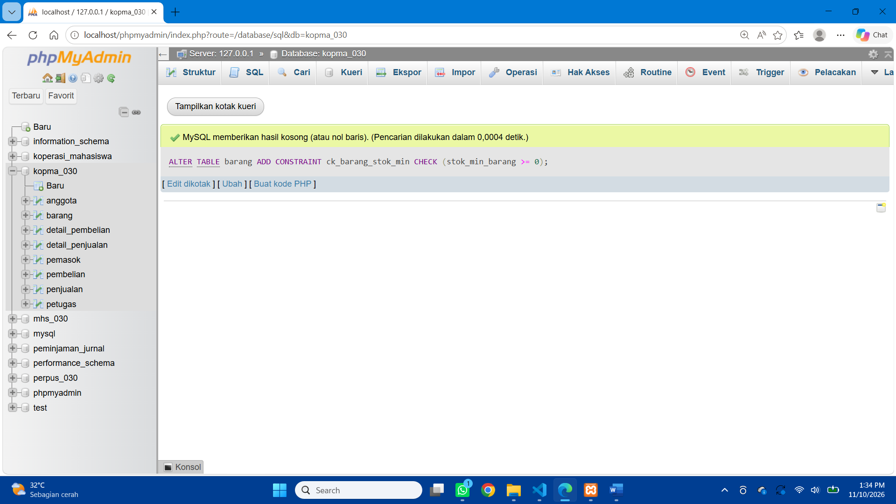

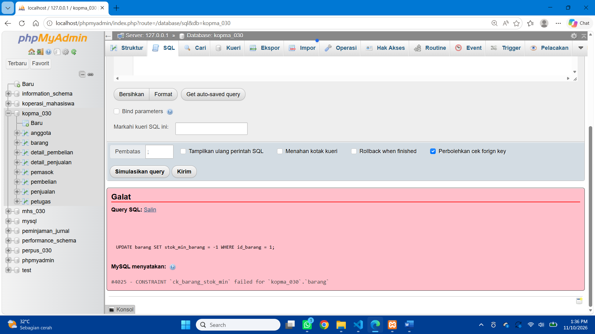

**Latihan 2 - ON DELETE SET NULL pada fk_penjualan_anggota**

```sql
ALTER TABLE penjualan DROP FOREIGN KEY fk_penjualan_anggota;
ALTER TABLE penjualan
  ADD CONSTRAINT fk_penjualan_anggota FOREIGN KEY (id_anggota)
    REFERENCES anggota (id_anggota) ON DELETE SET NULL;
```

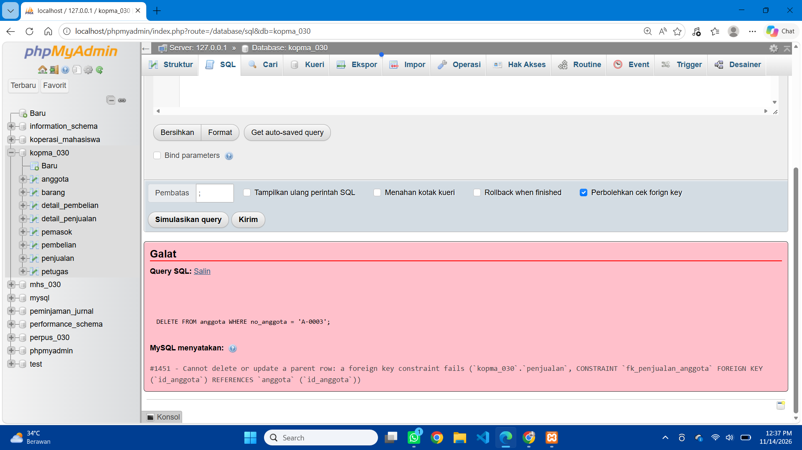

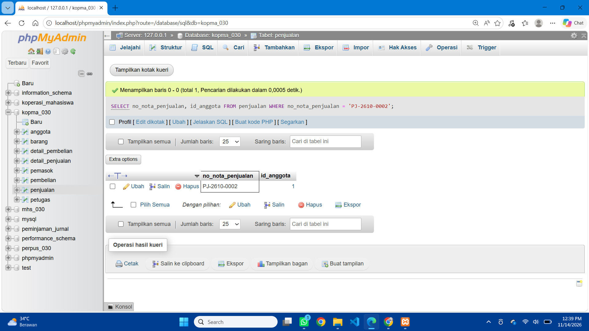

Secara struktur, perubahan ke `ON DELETE SET NULL` tidak melanggar AB-02, karena aturan itu memang membolehkan nota tanpa anggota (`id_anggota` boleh kosong). Pada percobaan saya, anggota A-0003 (Sari) ditolak dihapus dengan galat 1451 sebelum perubahan, lalu setelah perubahan ia berhasil dihapus dan nota PJ-2610-0002 tetap ada dengan `id_anggota` bernilai NULL. Dari sisi UU PDP hasil ini menguntungkan, sebab data pribadi anggota bisa dihapus tanpa ikut menghapus catatan transaksi. Harganya, nota itu kini tampak seperti pembelian pembeli umum padahal diskon 5% sudah diberikan, sehingga dasar diskonnya tidak bisa ditelusuri dan belanja Sari hilang dari KI-04 (anggota dengan belanja terbesar). Menurut saya SET NULL layak dipakai bila Kopma memang mengutamakan hak penghap.

## 6. Tugas Mandiri: Milestone Proyek 5 (Perpustakaan Cendekia AFR)

**Skrip:** `p05_ddl_25430030.sql` (7 tabel, dapat dijalankan ulang dari basis data kosong).

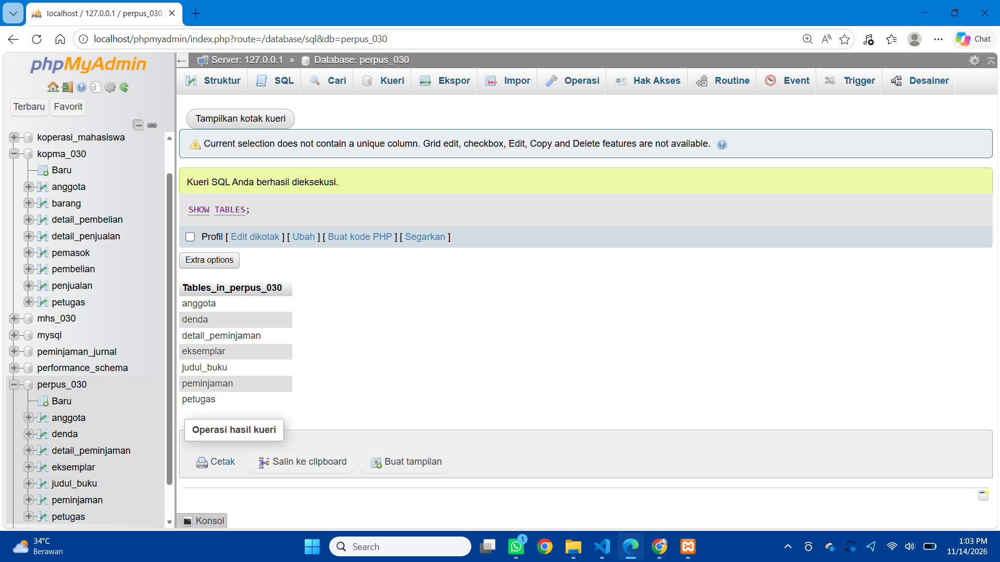


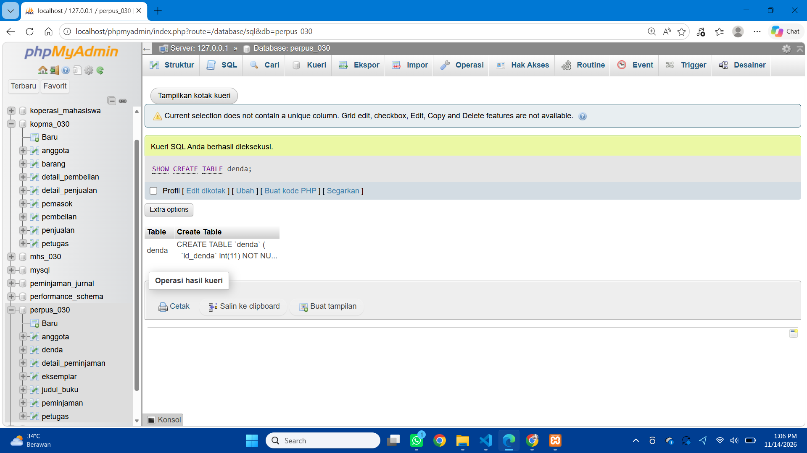

**Pemetaan tipe data**

| Elemen kamus data | Tipe MariaDB | Alasan |
|---|---|---|
| no_slip_peminjaman | CHAR(12) | Formatnya tetap 12 karakter (PJ-YYMM-nnnn), jadi CHAR lebih tepat dan lebih ringkas daripada VARCHAR |
| tanggal_pinjam, tanggal_harus_kembali, tanggal_kembali | DATE | Yang dibutuhkan hanya tanggal tanpa jam, dan DATE bisa dibandingkan serta dihitung selisih harinya untuk denda |
| status_aktif, kondisi_eksemplar, status_eksemplar | ENUM | Nilainya terbatas dan pasti, sehingga server menolak nilai di luar daftar |
| no_hp_anggota | VARCHAR(15) | Nomor telepon bisa diawali nol, jadi disimpan sebagai teks; ini data pribadi sehingga dibuat NULL dan aksesnya dibatasi |
| id_peminjaman, id_anggota, dan kunci pengganti lain | INT AUTO_INCREMENT (SMALLINT untuk petugas) | Kunci yang tidak pernah berubah; petugas jumlahnya sedikit sehingga SMALLINT cukup |

**Constraint dan aturan bisnis**

| Constraint | Aturan yang dijaga (AB) | Alasan |
|---|---|---|
| uq_peminjaman_slip | AB-01 | Nomor slip harus unik agar satu slip tidak tercatat dua kali |
| ck_peminjaman_tanggal | AB-03 | Batas kembali tidak boleh lebih awal dari tanggal pinjam; aturan ini menyangkut satu baris sehingga bisa dijaga CHECK |
| fk_detail_peminjaman (CASCADE) | AB-01 | Rincian tidak berarti tanpa slipnya, sehingga ikut terhapus bila slip dibatalkan |
| uq_denda_detail | AB-06 | Satu buku dalam satu slip paling banyak satu denda (relasi 0..1), sehingga denda ganda tertolak |
| fk_detail_eksemplar (tanpa CASCADE) | AB-05 | Eksemplar yang pernah dipinjam tidak boleh dihapus agar riwayat peminjaman tetap utuh |

**Aturan yang tidak dapat dijaga constraint (ditandai untuk Modul 14)**

| Aturan | Mengapa CHECK tidak dapat menjaganya |
|---|---|
| Batas 6 buku per slip (P + 2) | Menyangkut jumlah baris detail dalam satu peminjaman, sedangkan CHECK hanya menilai satu baris; dijaga lewat transaksi di Modul 14 |
| Eksemplar berstatus dipinjam tidak boleh dipinjamkan lagi (AB-05) | Harus membaca status di tabel eksemplar lalu mengubahnya bersamaan dengan pembuatan rincian, yaitu dua langkah pada dua tabel yang perlu satu transaksi |
| Slip minimal berisi satu buku (AB-01) | Slip dibuat lebih dulu dan rinciannya menyusul, sehingga struktur tabel tidak bisa memaksa jumlah baris minimal |

**Perbandingan Designer dengan ERD proyek**

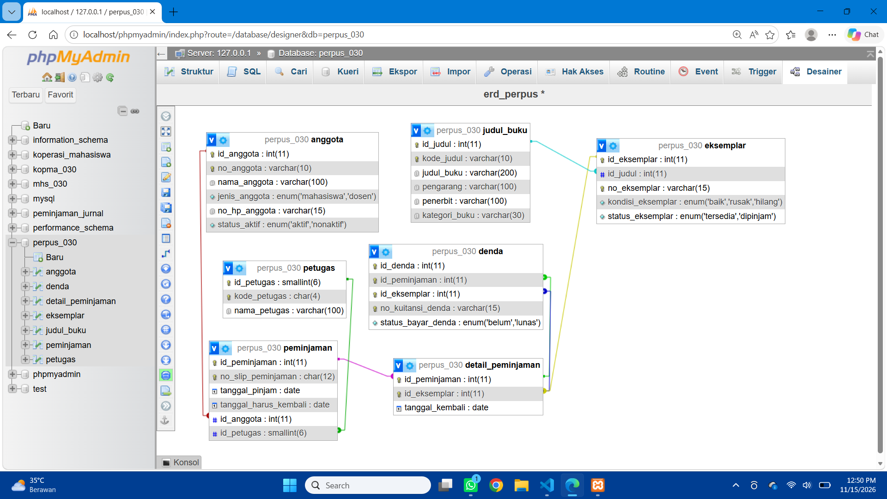


**ERD fisik proyek**

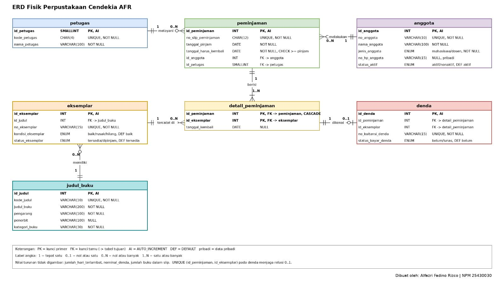

nominal_denda dihitung, bukan disimpan, karena nilainya hanya hasil jumlah hari terlambat dikali Rp4.000 (AB-06); menyimpannya membuka peluang selisih bila tanggal kembali dikoreksi. tanggal_harus_kembali berada di peminjaman karena AB-03 menetapkan masa pinjam 7 hari untuk seluruh buku dalam satu slip, sehingga atribut itu hanya bergantung pada slip (syarat 2NF), dan tetap disimpan agar slip lama tidak berubah bila masa pinjam kelak diubah. Kunci unik uq_denda_detail dibuat agar satu buku dalam satu slip tidak dikenai denda ganda dan agar relasi detail ke denda yang 0..1 dijaga oleh struktur tabel, bukan hanya oleh aplikasi.

## 7. Pembahasan dan Kendala

 MySQL mati sendiri saat dijalankan tanpa hak administrator; perintah `git commit` tanpa `-m`; salah ketik nama atau urutan tabel yang memicu galat 1005 atau 1451; membedakan galat 1062 dari dua constraint berbeda.

## 8. Kesimpulan

Praktikum ini mewujudkan skema hasil normalisasi menjadi 8 tabel Kopma dan 7 tabel Perpustakaan melalui DDL yang dapat dijalankan ulang. Percobaan membuktikan bahwa kunci tamu, UNIQUE, dan CHECK benar-benar menolak data salah dengan galat 1452, 4025, dan 1062, tetapi hanya untuk aturan yang menyangkut satu baris atau hubungan antartabel. Aturan seperti batas 6 buku per slip dan eksemplar yang sedang dipinjam masih menunggu transaksi di Modul 14. Saya juga memahami bahwa memilih aksi ON DELETE, seperti CASCADE dan SET NULL, adalah keputusan bisnis yang memengaruhi riwayat transaksi, bukan sekadar pengaturan teknis.

## 9. Pernyataan Penggunaan AI

saya menggunakan claude ai untuk membantu menyelesaikan tugas dan laporan dalam modul ini.

## 10. Bukti Git

- Repositori: https://github.com/alfazridino160-hue/basisdata_25430030
- Hash commit: erd fisik dan ddl proyek : b2d05e1
               ddl kopma                : 674b2fa
- Pesan commit: p05: ddl kopma dan p05: ddl proyek

## Checklist

**Checklist umum**

- [ ] Identitas lengkap (nama, NPM, kelas, pertemuan, tanggal, asisten/dosen)
- [ ] Tujuan ditulis dengan bahasa sendiri (maks. 5 baris)
- [ ] Ringkasan teori maks. setengah halaman, tanpa menyalin buku
- [ ] Tangkapan layar langkah kunci disertai keterangan
- [ ] Semua Titik Analisis dijawab dengan alasan
- [ ] Latihan (E) disertai bukti
- [ ] Tugas Mandiri (F) berisi berkas, bukti, dan penjelasan desain
- [ ] Pembahasan memuat kendala, cara membaca galat, dan cara mengatasi
- [ ] Kesimpulan 2-4 kalimat
- [ ] Pernyataan penggunaan AI
- [ ] Bukti Git (tautan repositori dan hash commit)
- [ ] Keaslian: komentar AB-xx merujuk dokumen kebutuhan data sendiri; nama constraint memakai pola pk_, fk_, uq_, ck_

**Checklist khusus Pertemuan 5**

- [ ] `p05_ddl_25430030.sql` (dapat dijalankan ulang dari basis data kosong) dan `p05_erd_fisik_25430030`
- [ ] Bukti tangkapan layar: SHOW CREATE TABLE tabel utama; galat saat constraint dilanggar (FK, UNIQUE, CHECK)
- [ ] Analisis: alasan pemilihan tipe data dan constraint; kaitan constraint dengan AB-xx
